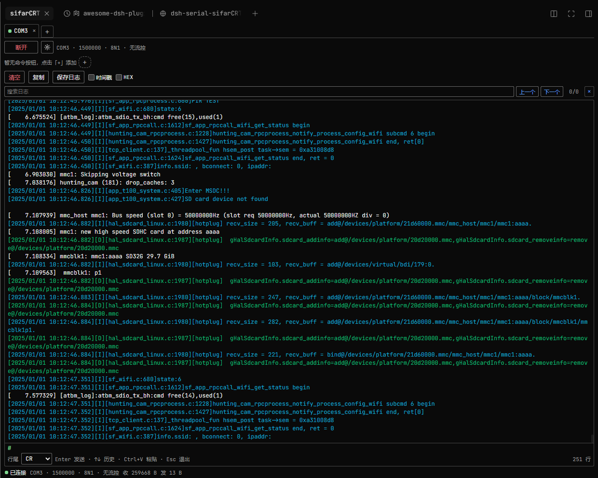

# dsh-serial-sifarCRT

[](https://www.npmjs.com/package/dsh-serial-sifarcrt)
[](./LICENSE)
[](https://github.com/topics/dsh-plugin)

A SecureCRT-style **Windows serial debug console** that lives in the DeepSeek Harness (DSH) **right sidebar**. Configure a COM port from a dialog, connect, watch hardware debug output with ANSI colors, and type Linux commands directly into the log window — with several serial ports open side by side in tabs.

> 中文简介见下方「中文说明」。



<sub>sifarCRT connected to a board: per-line ANSI colors (`[I]` cyan, `[D]` green, `[E]` red, plain kernel lines white), the in-log `#` terminal with blinking caret, command buttons, and the keyword log search row.</sub>

## Features

- **Right sidebar panel** — registered as a native right-sidebar tab type (`sifarCRT` in the right column's guide). Opening it does not replace the built-in right-sidebar pages.
- **Serial settings dialog** — a gear button opens one dialog with port (auto-enumerated, with adapter descriptions), baud rate (editable, presets 9600 / 115200 / 1500000, default 1500000, valid 50–1500000), parity (default None), flow control (default 无/None), data bits and stop bits. Confirm, then Connect/Disconnect from the toolbar.
- **ANSI colors** — Linux ANSI SGR sequences such as `ESC[0m`, `ESC[36;22m` and `ESC[7m` are parsed and rendered (16 / 256 / truecolor, bold, dim, italic, underline, reverse, hidden). Colors are applied **per log line**: the color set at the start of a line colors that line, while lines with no ANSI (kernel/plain output) use the default text color — no bleed-over into following lines. Other cursor/clear control sequences are hidden instead of shown as garbage. A streaming parser keeps state across serial chunks.
- **In-log Linux terminal** — click the log pane and type directly: green `#` prompt with a blinking caret, `Enter` sends (an empty Enter sends a bare CR so the board prints its prompt), `Backspace`, `↑/↓` command history, `Ctrl+V` paste (multi-line paste sends line by line), `Escape` to leave the keyboard. `Ctrl+C` sends a single `0x03` (ETX) to interrupt a foreground program such as `top`; with text selected it copies instead.
- **Keyword search** — a search box highlights every match in the visible log (current match emphasized), with 上一个/下一个 navigation, an `n/m` counter and a clear button. `Enter` goes to the next match, `Shift+Enter` to the previous, `Escape` clears; navigating centers the match and pauses auto-follow.
- **Log scrolling that stays out of the way** — pressing the left mouse button in the log pauses auto-follow while data keeps arriving; releasing at the bottom resumes. Dragging the scrollbar up keeps the old view without jumping on new data; scrolling back to the bottom, pressing `Enter`, or clicking “已暂停 · 跟随最新” resumes.
- **Command buttons** — user-defined command chips that send a stored command with its own line ending; add, edit and delete them (double-click or right-click a chip). Kept per tab in `localStorage`.
- **Copy / save** — select text to copy, or copy the whole visible log; export the current tab as a plain-text `.log` file. Locally sent bytes are not echoed into the log — the board's own tty echo is what you see, exactly like SecureCRT.
- **Multiple tabs** — one independent serial session per tab, several ports open at the same time; tab configuration persists across page reloads (ports are not auto-reconnected).
- **Bounded logs** — the Host keeps the last 4000 entries / 8 MB per session; the panel renders the last 2000.

## Requirements

- **Windows** (uses the in-box Windows PowerShell 5.1 + .NET `System.IO.Ports`; no native Node module and no compiler are needed).
- **DSH `^0.2.1-rc.1`** (the right-sidebar tab API of dsh 0.2.1+).
- No package dependencies, no build step.

## Install

**From npm (after the package is published):**

```sh
dsh plugin --profile web add dsh-serial-sifarcrt
```

**From GitHub source (works without npm):**

```sh
dsh plugin --profile web add github:xf3193/dsh-serial-sifarCRT
```

**From a local tarball:**

```sh
npm pack
dsh plugin --profile web add ./dsh-serial-sifarcrt-1.0.2.tgz
```

Replace `web` with your profile name (Desktop users: install from **Settings → Plugins** instead). After installation, refresh the DSH page once and open the right sidebar → **sifarCRT** in the guide.

Uninstall: `dsh plugin --profile web remove dsh-serial-sifarcrt`.

## How it works

| Half | File | Responsibility |
|---|---|---|
| Host | `lib/index.js` | Multi-session manager, `POST/GET /dsh-serial-sifarcrt/*` HTTP API on `ctx.webServer`, bounded per-session logs |
| Host | `lib/serial-helper.ps1` | One persistent Windows PowerShell child per serial session, `System.IO.Ports` over NDJSON stdio |
| Client | `lib/client.js` | Right-sidebar tab-type registration, ANSI renderer, in-log terminal, settings dialog, tabs, command chips (React, no build step) |

The full Host↔Client protocol contract is documented in [docs/CONTRACT.md](./docs/CONTRACT.md).

The plugin needs **no network access**. It reads/writes the local COM ports you select and stores tab/command/line-ending preferences in the page's `localStorage`. It spawns `powershell.exe` children that it owns and terminates with the plugin.

## Security notes

- Installing any DSH plugin runs third-party code with your user permissions. This plugin only opens the serial ports you explicitly connect and does not send data anywhere.
- `OS`-limited to Windows; the Host half will not start its serial bridge on other platforms.
- The optional diagnostics endpoint writes a mount report to the OS temp directory (`dsh-serial-sifarcrt-report.json`) for troubleshooting; it contains no serial data.

## Development

The package ships the exact files it runs — there is no bundler:

```sh
node --check lib/index.js
node --check lib/client.js
node test/host-test.mjs   # Windows + real COM ports required
```

## Known limitations

- One port is exclusive: a COM port already held by another program cannot be opened.
- The log is a record view: ANSI colors are honoured, but cursor movement / clear-screen sequences are ignored rather than reflowing text (progress bars may appear as several lines).
- Paused scroll keeps the rendered position; when the 2000-line render cap is hit, the oldest rendered lines are dropped.
- Windows-only by design.

## 中文说明

DSH 右侧栏的 Windows 串口调试台（SecureCRT 风格）：

- 齿轮图标弹出串口设置（串口自动枚举、波特率可编辑默认 1500000、校验位默认 None、流控默认无、数据位/停止位），确定后连接/断开；
- 日志按 ANSI 颜色渲染，Linux `#` 命令行可直接在日志窗口输入（回车发送、↑↓ 历史、Ctrl+V 粘贴、Ctrl+C 中断 top 等前台程序）；
- 命令按钮栏可增删改；多标签页可同时开多个串口；
- 日志滚动跟随：按住鼠标暂停、拖滚动条回看旧日志不跳动、回车或滚到底部恢复；
- 支持复制与导出 `.log`；本地发送不重复回显（显示板端 tty 回显）。

安装：`dsh plugin --profile web add dsh-serial-sifarcrt`（或 `github:xf3193/dsh-serial-sifarCRT`），刷新页面后从右侧栏指南打开 sifarCRT。仅支持 Windows，需要 DSH 0.2.x。

## License

MIT. `lib/serial-helper.ps1` is adapted from [floydc-sz/dsh-serial-debugger](https://github.com/floydc-sz/dsh-serial-debugger) (MIT); see [LICENSE](./LICENSE) for the full text and third-party notice.
